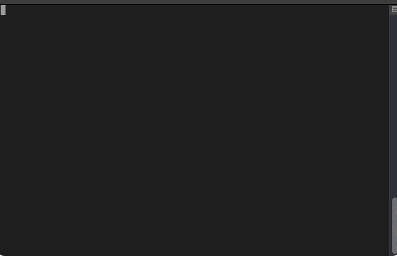

# Teaching Python Post-Production CLI (`tppp`)

A command-line pipeline for automating post-production of the [Teaching Python](https://teachingpython.fm) podcast. Built with Python, it handles audio enhancement, transcription, filler-word removal, and transcoding — replacing a manual multi-step workflow with a single tool.

## Features

- Audio enhancement via [Dolby.io](https://dolby.io/) (loudness, noise reduction, dynamic range, EQ)
- Audio and speech analysis via Dolby.io
- Transcription via [AssemblyAI](https://www.assemblyai.com/) with speaker labels, word boosting, auto-chapters, and highlights
- Local transcoding to MP3 via [ffmpeg](http://ffmpeg.org/) with intro/outro music support, normalization, and crossfade
- Filler word detection and removal from audio using transcript data
- S3-compatible storage via AWS (presigned uploads)
- Per-run logging to `logs/`



## Requirements

- Python 3.13+
- [uv](https://docs.astral.sh/uv/getting-started/installation/)
- [ffmpeg](http://ffmpeg.org/) installed locally (for transcoding)
- AWS credentials configured (for S3 presigned URL features)

## Installation

```bash
git clone https://github.com/teachingpython/post-production.git
cd post-production
uv sync
```

## Configuration

Create a `.env` file in the project root (or copy from `.env.example`):

```dotenv
DOLBY_API_KEY=your_dolby_api_key
ASSEMBLYAI_API_KEY=your_assemblyai_api_key
```

- Dolby.io — sign up at [dolby.io/signup](https://dolby.io/signup)
- AssemblyAI — sign up at [assemblyai.com](https://app.assemblyai.com/login/)

The CLI loads `.env` automatically via `python-dotenv`. If a key is missing at runtime, you'll be prompted to enter it interactively.

## Usage

All commands are accessed through the `tppp` CLI entry point.

```bash
uv run tppp --help
uv run tppp --version
```

### `enhance` — Dolby.io Audio Processing

Enhance, analyze, or speech-analyze an audio file through Dolby.io.

```bash
# Enhance a local file (uploads, processes, downloads result)
uv run tppp enhance episode.wav

# Enhance with a custom output path
uv run tppp enhance episode.wav --output enhanced/

# Analyze audio quality
uv run tppp enhance episode.wav --analyze

# Analyze speech characteristics
uv run tppp enhance episode.wav --analyze-speech

# Use a pre-uploaded URL instead of a local file
uv run tppp enhance --in-url "dlb://in/episode.wav"
```

| Option             | Description                                       |
| ------------------ | ------------------------------------------------- |
| `INFILE`           | Local audio file to upload and process            |
| `--output PATH`    | Output directory or file path                     |
| `--analyze`        | Run audio analysis instead of enhancement         |
| `--analyze-speech` | Run speech analysis instead of enhancement        |
| `--in-url URL`     | Skip upload; use an existing Dolby-compatible URL |
| `--out-url URL`    | Custom S3 output object path                      |

### `transcribe` — AssemblyAI Transcription

Transcribe audio with optional chapters, highlights, and filler word detection.

```bash
# Transcribe a local file
uv run tppp transcribe --file episode.wav

# Transcribe from a URL
uv run tppp transcribe --url "https://example.com/episode.wav"

# With chapters and filler words
uv run tppp transcribe --file episode.wav --chapters --disfluencies
```

| Option               | Description                                       |
| -------------------- | ------------------------------------------------- |
| `--file, -f PATH`    | Local audio file to upload and transcribe         |
| `--url, -u URL`      | Audio URL to transcribe directly                  |
| `--chapters, -c`     | Generate automatic chapter markers and summaries  |
| `--highlights, -h`   | Generate automatic highlights and keywords        |
| `--disfluencies, -d` | Include filler words (um, uh, etc.) in transcript |

You'll be prompted to optionally add priority words for improved transcription accuracy.

### `retrieve` — Fetch a Previous Transcription

Download results from a previously submitted AssemblyAI job.

```bash
uv run tppp retrieve JOB_ID --output transcript
```

| Argument/Option | Description                          |
| --------------- | ------------------------------------ |
| `JOB_ID`        | AssemblyAI job ID to retrieve        |
| `--output PATH` | Output file path (without extension) |

### `chapters` — Extract Chapter Markers

Parse chapters and highlights from a saved AssemblyAI JSON result.

```bash
uv run tppp chapters result.json
```

Outputs chapter timestamps, headlines, and summaries to the terminal and writes a `chapters.txt` file.

### `transcode` — FFmpeg Audio Transcoding

Convert audio to MP3 with optional normalization and intro/outro music.

```bash
# Basic transcode to MP3
uv run tppp transcode episode.wav

# With normalization and music
uv run tppp transcode episode.wav \
  --normalize \
  --normalization-level 16 \
  --intro-music intro.mp3 \
  --outro-music outro.mp3 \
  --output-file final.mp3
```

| Option                      | Description                                     |
| --------------------------- | ----------------------------------------------- |
| `INPUT_FILE`                | Audio file to transcode                         |
| `--output-file PATH`        | Output file path (defaults to `<input>.mp3`)    |
| `--normalize`               | Apply loudness normalization                    |
| `--dynamic-normalize`       | Apply dynamic normalization                     |
| `--normalization-level INT` | Target LUFS (e.g. `16` → -16 LUFS, default: 19) |
| `--intro-music PATH`        | Audio file to crossfade before the episode      |
| `--outro-music PATH`        | Audio file to crossfade after the episode       |

## Project Structure

```
post_production/
├── main.py              # CLI entry point (Typer app)
├── dolby.py             # Dolby.io API client
├── dolby_cli.py         # Dolby.io CLI command
├── assembly_ai.py       # AssemblyAI API client
├── assembly_ai_cli.py   # AssemblyAI CLI commands
├── transcoding.py       # FFmpeg transcoding command
├── aws_helpers.py       # S3 presigned URL helpers
└── extract_fillers.py   # Filler word detection and removal
tests/
└── test_post_production.py
```

## Development

```bash
# Install all dependencies (including dev)
uv sync

# Run tests
uv run pytest

# Lint and format
uv run ruff check --fix post_production/ tests/
uv run ruff format post_production/ tests/

# Set up pre-commit hooks
uv run pre-commit install
```

## License

MIT
